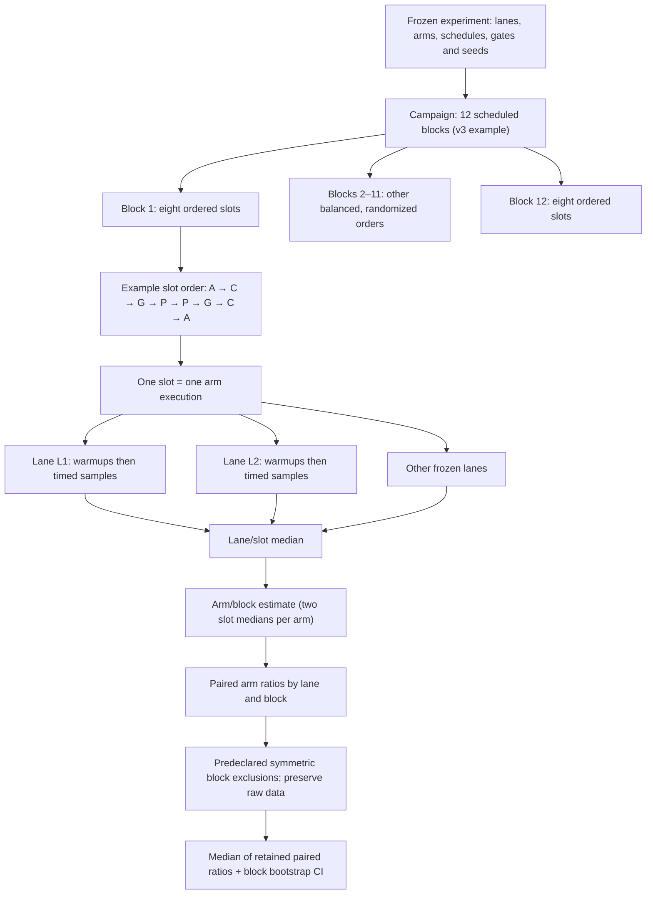

# Benchmarking architecture and methodology

> **Benchmark-framework migration status:** **BM series CLOSED; BM-10 DONE — MERGED** ([PR #113](https://github.com/yduchesne/quervant/pull/113), 2026-11-22). BM-09 remains **DONE — TERMINATED INCOMPLETE** ([PR #110](https://github.com/yduchesne/quervant/pull/110), closed unmerged), preserved on its [archival branch](https://github.com/yduchesne/quervant/tree/archive/bm09-incomplete-20261122). The original cross-engine warm result used non-equivalent Tantivy numeric-ordinal sorting and remains historical; a separate **COMPLETE 16-lane native `doc_id` string-sort warm result** is now recorded in [`benchmarks/studies/cross-engine/warm/results/`](../benchmarks/studies/cross-engine/warm/results/quervant-tantivy-lucene-lexical-sort-warm-2026-11-22-001.json), with all A/A controls passing. Retained-key and process-cold real studies remain outstanding **benchmark operations**, so the three-study `v0.1-bench` **C6 criterion is NOT COMPLETE**. The [BM roadmap](benchmarking/BENCHMARKING_ROADMAP.md) records this distinction. Historical methodologies and frozen verdicts are unchanged.

## Benchmark configuration and result artifact naming (permanent convention)

**Format references:** [Benchmark configuration JSON — field dictionary, values and validation](BENCHMARK_CONFIGURATION.md) and [Benchmark result JSON — field dictionary, analysis and configuration relationship](BENCHMARK_RESULT.md). The references document the currently implemented `benchmark-configuration-v1` and `benchmark-result-v1` shapes; this section remains the permanent naming/retention authority. In particular, [how a result relates to its configuration](BENCHMARK_RESULT.md#2-how-a-result-relates-to-its-configuration) is defined explicitly, including matching `configuration_id`, the originating `configuration_file` and the embedded configuration snapshot.

This is the **repository-wide naming, study layout, and retention convention for new benchmark artifacts**, independent of any BM milestone or implementation PR. It does **not** retroactively rename frozen historical configurations, reports or evidence.

### Permanent study-directory hierarchy

All new benchmark configuration and result JSON files are organized under:

```text
benchmarks/studies/<family>/<regime>/
    configurations/<name>-<creation-yyyy-mm-dd>.json
    results/<same-name>-<execution-yyyy-mm-dd>-<NNN>.json
```

The configuration's family and measurement regime determine its path. Results always go to the **sibling `results/` directory of their configuration's `configurations/` directory**, not to a caller-selected directory. The CLI selects these locations automatically; a custom `--studies-root` may change the outer root without changing the enforced layout.

| Supported family | Regime directory | Measurement rationale |
| --- | --- | --- |
| `retained-key` | `warm` | Retrospective duplicate-detection strategy performance in warmed search workloads |
| `cross-engine` | `warm` | 16-lane warm search performance and separately measured serial throughput |
| `cross-engine` | `cold-start` | One predeclared 10K/medium/K100 process-launch-to-first-response lane |
| `perf-02` | `warm` | Prospective pinned Quervant A/B comparison: two independent production-default builds, 16 warm exact-keyword lanes |

**Deliberate asymmetry:** There is **no `retained-key/cold-start/` or `perf-02/cold-start/` directory**; these studies compare warm query execution, not process-startup overhead. Only actual supported studies get directories. An additional family/regime combination requires an explicit methodology and validator change; the framework must not silently create speculative or unsupported study directories.

Names and `configuration_id` values are **unique across all configurations in the entire `studies/` tree**, not just within one family or regime. Each configuration's result suffix sequence is independent of every other configuration, but advances across dates. The result's `configuration_file` remains the original **basename**, while the result's study directory identifies the sibling configuration directory. An empty `results/` directory is created on first publication; Git does not track empty directories and no placeholder or additional benchmark artifact is required.

The published JSON is portable for read-only reporting/reanalysis after copying. Publication, creation and measurement, however, enforce the family/regime directory and cannot route the same result to another study. See the [result-to-configuration reference](BENCHMARK_RESULT.md#2-how-a-result-relates-to-its-configuration).

### PERF-02 prospective A/B warm study

PERF-02-A adds a Quervant-only `perf-02/warm` study. Arm `A` is the accepted production baseline; arm `B` is the proposed candidate. Both must declare **full pinned Git commit SHAs** and are built independently with release/locked settings, separate build directories, and no experimental duplicate-strategy override. The normal scheduling, host readiness, correctness, paired statistics, A/A control and immutable result lifecycle are reused. An A=A **stage-only** smoke configuration (same SHA, two independent builds) permits host/build/index and untimed oracle validation, **not** a search speedup, A/A statistical qualification or a completed benchmark acquisition. PERF-02-A never calls `run`; timed A/B campaigns require a separate PERF-02-B authorization. PERF-02-B will create a new immutable configuration once a candidate revision and warm acceptance criteria exist. Only qualified uninstrumented warm comparisons can select a query optimization; Criterion/perf attribution remains diagnostic.

### Configuration files

- Persist each new benchmark configuration at `benchmarks/studies/<family>/<regime>/configurations/<name>-<yyyy-mm-dd>.json`, using the exact basename `<name>-<yyyy-mm-dd>.json`.
- `<name>` is a stable, human-readable, lowercase, hyphen-separated filename slug (for example, `retained-key-prefilter`). The JSON also contains a separate concise, human-readable `description`.
- `<yyyy-mm-dd>` is the **configuration creation date in UTC**, not the benchmark execution date.
- Every configuration contains a **stable, unique `configuration_id`** (for example a UUIDv4 or a content-derived identifier). The ID identifies the experiment specification, not an approval, signature or integrity certificate. Record the effective workload, participating arms, schedule and statistical settings in the configuration.
- A configuration's ID, name and creation-date filename must remain stable after results refer to it. Any material change to the measured work, arms or statistical methodology creates a **new configuration and ID**, rather than silently changing the old one.
- To prevent ambiguous result filenames, **a configuration name is unique across configuration IDs and all study directories**. Use a distinct descriptive name (for example a `-v2` suffix within the name) for a new configuration rather than reusing a previous configuration's name, even if its creation date differs. Never overwrite an existing configuration file.

### Result files

- Persist each new benchmark result in its configuration's sibling `results/` directory, as `<name>-<yyyy-mm-dd>-<suffix>.json`.
- `<name>` is **exactly** the name of the referenced configuration file, without its date or `.json` extension. Do not rename, abbreviate or independently generate a result name.
- `<yyyy-mm-dd>` is the **benchmark execution date in UTC**, which can differ from the configuration creation date. Preserve a complete, unambiguous, timezone-aware execution timestamp inside the JSON.
- `<suffix>` begins at **`001`** and increments `002`, `003`, etc., **for that configuration across all execution dates**. It never resets on a new day. If 999 runs are exhausted, fail with an explicit naming-limit diagnostic until a separately documented revision extends the format; never wrap or reuse a suffix.
- Each result identifies its source configuration using **`configuration_id`**, not filename matching alone, and records the exact configuration filename, its own unique `run_id`, the sequence number, timestamp, raw samples, final computed statistics and decision/limitation statuses. The stored name, date and sequence agree with the corresponding filenames.
- Allocate filenames **automatically, without user interaction**, using safe collision handling and non-overwriting, exclusive/atomic creation, including when two executions compete for the next sequence. If automatic allocation or result writing fails, preserve any collected measurements and give a clear diagnostic; never replace a previous result.
- Keep configuration and result JSON artifacts in the repository for Git versioning. A run must **save its local files without approval**; successful Git commit/push is a separate repository operation and remote availability must not determine whether measurements are preserved.

### Example

```text
benchmarks/studies/retained-key/warm/configurations/retained-key-prefilter-2026-11-21.json
benchmarks/studies/retained-key/warm/results/retained-key-prefilter-2026-11-21-001.json
benchmarks/studies/retained-key/warm/results/retained-key-prefilter-2026-11-22-002.json
benchmarks/studies/retained-key/warm/results/retained-key-prefilter-2026-11-22-003.json
```

All three results have the same `configuration_id` and filename name (`retained-key-prefilter`) but **different `run_id` values**. The suffix advances across dates.

### Human-readable reports and replay

The result JSON is the authoritative measured-and-analyzed output. A `replay`/`report` operation **only parses the saved JSON and renders its existing values and conclusions** into a human-readable report, ordinarily a Markdown file with the same filename stem and the `.md` extension. It does not rerun measurements, rederive statistical calculations, require a second checkout, or perform approval/integrity certification. Ordinary parsing and safe file handling are permitted. Recomputing new statistics, if supported, is a separately named and explicitly requested reanalysis operation.

## Current comparative methodology — recovered from BM-09 for BM-10

This section adopts the **scientific comparison principles** developed on the [unmerged BM-09 branch](https://github.com/yduchesne/quervant/blob/dev/bm09-real-qualification/docs/BENCHMARKING.md), especially the [within-run and historical proportional-effect specification](https://github.com/yduchesne/quervant/blob/dev/bm09-real-qualification/docs/pr-artifacts/bm-09/design-and-contracts.md). It is guidance for **new BM-10 studies**, not a change to historical experiment decisions. It does **not** adopt BM-09's authorization, cryptographic evidence identity, receipt, attestation or repeated offline-replay machinery.

### Query benchmark execution sequence (permanent methodology)

**Invariant: index construction is a prerequisite, never part of query latency.** Every query-performance study (including future PERF optimization campaigns) follows the three stages below **for each participating arm and corpus**. Specify the corpus, index generation, query semantics, source/strategy, cache regime, timing boundary and measurement policy before acquisition. The separate indexing metrics are descriptive write-side observations unless a distinct, explicitly designed indexing benchmark qualifies them. Neither warm query latency nor cold-start first-response latency includes building or committing documents.

1. **Build, commit and validate the index — outside query acquisition.** Generate or load the declared corpus, create each arm's index, insert the documents and commit the finished index. Reopen/verify the committed generation as prescribed, checking document counts and applicable correctness invariants before the query phase. Record `index_metrics` separately: `index_ns` (insertion), `commit_ns`, `reopen_ns` (build-verification reopen), and `index_bytes`. These operations occur **before** the A/A and treatment query measurements; their durations must **never** be added to `engine_ns` or to cold-start first-response wall time. Failure to build, commit or verify the required index blocks valid query results; do not treat an unfinished index as a fast query.
2. **Open the existing index and prepare the reader — separate from query execution.** Open the committed index and initialize the relevant reader/snapshot/searcher **without inserting or committing any documents**. In a **warm** study, a session's initial opening precedes the adapter's `engine_ns` clock and that reader is reused for warmups and timed requests; the opening duration is not a warm search sample. In a **process-cold** study, start a fresh adapter process against the **already-built** index for each observation. The adapter separately times index/reader initialization as `index_open_ns` and reports it on its first successful query response; this duration excludes the query's own `engine_ns`. The runner's end-to-end cold wall timer deliberately includes process startup, index opening, query work and JSONL transport, but **not** index construction. Note that index opening does not guarantee all physical reads have occurred: lazy index/page-cache access can still happen during search, and process-cold does not guarantee a cold OS page cache.
3. **Execute, validate and record the declared query — never time indexing.** For warm studies, execute the complete predeclared randomized, balanced block/slot schedule; **within each slot and lane**, perform the configured **untimed warmups before its timed query samples**. Each adapter's `engine_ns` covers the declared search/index-access operation and required Top-K/result materialization **only**; it excludes index opening, document insertion, commit, protocol serialization and external correctness-oracle checks. For process-cold studies, perform the declared **single first query per fresh process**, with no warmups: retain `samples_ns` (process launch to first complete response), `index_open_samples_ns`, `engine_samples_ns`, and `other_overhead_samples_ns = samples_ns − index_open_samples_ns − engine_samples_ns`. These components must reconcile **for each observation**; the residual includes process/JVM startup, scheduling and transport and is not a pure OS-startup measure. Verify exact results against the independent oracle, apply host-readiness and A/A controls, and preserve every acquired sample even if a subsequent check invalidates the run. A missing/incorrect response, invalid timer or incomplete series yields an **INCOMPLETE/invalid** result, not an accepted latency claim.

**Scope and comparison rules:** Warm `search_latency` uses query-only `engine_ns`; cold `cold_start_first_response_latency` uses launch-to-first-response wall time. These are distinct metrics with separate immutable configurations, statistical analyses and result JSON files and **must not be pooled**. In particular, the build-phase `reopen_ns` is **not** the per-process cold-query `index_open_ns`. For a write-performance comparison, define a separate indexing/commit workload and qualification procedure; do not derive a statistically qualified write-performance claim from the query campaign's descriptive build metrics.

This procedure is the **current permanent rule**. Older historical acquisition and freeze/attestation descriptions later in this document remain records of earlier studies; they do **not** supersede this sequence or reintroduce BM-09 administrative gates. See [configuration format](BENCHMARK_CONFIGURATION.md#3-workload-object), [result fields](BENCHMARK_RESULT.md#6-raw_samples-treatment-measurements), and the [BM-10 operator guide](../benchmarks/BM10_README.md#method-and-comparability).

### Reusable preparation versus timed query acquisition (permanent rule)

**Preparation may be performed once and reused across multiple measurement runs, but never included in query latency.** The `quervant-bench stage --config <...>` command compiles the release adapters, generates the declared corpus, inserts/commits and reopens each index, validates correctness against independent **untimed** exact-query oracles, and saves **disposable local preparation inputs** under `target/bm10/prepared/<cache-key>/`. It does **not** execute A/A or treatment acquisition, write a benchmark result JSON, or claim comparative performance. The `run` command automatically performs this preparation if not already available; when the staged input identity matches and validation succeeds, it **reuses the prepared executables and indexes** rather than compiling and indexing again.

**Reuse identity and validity.** A preparation is reusable only when its full immutable configuration content/UUID, unchanged **Git object IDs of the build-relevant committed source files/trees** (including any pinned historical baseline), compiler/toolchain identity, relevant build environment and host platform match. The cache key incorporates these inputs; it is **not tied to Git HEAD alone**, so commits affecting only result JSON or documentation do not trigger needless rebuilding. Untracked result JSON, unrelated local outputs and documentation edits are ignored by the scoped source-cleanliness check; **uncommitted changes to build/runner source, adapters or relevant Cargo files are rejected**. The exact tested source SHA of the current query run is recorded separately in its result context. Before every reuse, check local input-file sizes/checksums (executables and Lucene distribution, corpora, index files), plus run an untimed independent search oracle for **every declared lane in every arm**. A missing or interrupted unpublished stage can be rebuilt. A completed cache whose recorded inputs fail validation **must not be used or deleted while another run might be reading it**: stop with a diagnostic; retire it only when no acquisitions use it. Never silently reuse stale or corrupt input. A configuration/source/toolchain/build change gets a different cache key and fresh preparation. No cache directory is a signed evidence archive, and no digest becomes an approval or qualification gate.

**Measurement discipline is unchanged.** Staging may warm OS page caches; `process-cold` never promises a cold OS page cache. After successful staging, **each** actual `run` independently checks host readiness, executes its prescribed complete randomized A/A and treatment schedule and appropriate throughput phase, and saves a distinct result JSON. A cache hit does **not** reuse timed query samples, A/A decisions, statistical outcomes or any host-readiness approval from a previous run. The index write/commit/reopen durations associated with a cached input set are **historical preparation-stage descriptions**, recorded with the preparation timestamp; do not attribute them to the current query campaign or treat them as statistically qualified write-performance results. Cache entry contents live under ignored `target/`, not under the versioned `studies/.../results/` tree, and do not constitute a third persisted benchmark artifact.

**Run-duration attribution.** Each result records `phase_durations_ns` for host preflight, input preparation/cache validation (including build, corpus generation, indexing and oracle checks on cache misses), A/A acquisition and analysis, treatment acquisition and analysis, and warm throughput when applicable. The renderer presents the saved durations without fresh clocks or reanalysis. Durations are wall-clock **orchestration** measurements; `preparation_build_ns`, `preparation_index_ns` etc. are **subcomponents** of `preparation_ns` and must not be added to the total again. `run_before_save_ns` deliberately excludes JSON publication/report rendering. These phase timings characterize where elapsed execution time goes; they are **not** query latency or cross-engine performance ratios.

### Query-optimization selection: warm performance is authoritative (permanent rule)

**A query optimization is evaluated and selected on statistically qualified *warm query* performance**, measured against the current accepted production baseline using the declared `search_latency`/`engine_ns` query-only operation. Predeclare representative target lanes, relevant Top-K/selectivity boundaries, guardrail lanes, estimator, confidence requirements and exclusion rules. An implementation can be accepted only after correctness and resource/safety invariants pass and its **warm** effects satisfy the candidate's predeclared improvement and regression criteria. A favorable cold-start measurement, a small `index_open_ns`, or a faster launch-to-first-response time **must not be used to qualify, rank, choose or promote a query optimization** when its warm search performance is insufficient, inconclusive or regressed.

**Cold-start results are a separately reported operational characterization, not a query-optimization selection signal.** Preserve and disclose total first-response time, index-opening time, query-only duration and other overhead, including any observed cold-start regression. Cold data may motivate a **separately scoped startup/reader-initialization optimization** with its own appropriate cold metric, constraints and approved evaluation contract, or trigger independent deployment/operational risk assessment if separately defined startup limits are violated. Such an operational concern must be recorded **without reinterpreting cold-start measurements as evidence that a query algorithm is faster or slower in steady-state execution**. A cold-only gain never compensates for a failed warm-query guardrail. A warm-qualified optimization remains a warm-qualified query-performance finding; it is not proof of improved cold-start behavior.

**Baseline progression:** Once a warm-qualified query optimization is accepted and incorporated into the production default, its implementation becomes part of the baseline for subsequent query studies. The independently saved cross-engine cold-start study can describe operational impact of that current baseline but is **not an extra query-optimization selection gate**. This rule applies to PERF-02 and later query-performance work, irrespective of BM-10's particular lane counts or study filenames.

### Within-run comparisons: treatment versus baseline

**Promoting accepted optimizations into the baseline (permanent rule).** Once an optimization has been qualified, accepted, and incorporated into the production Quervant default, **the accepted optimized behavior becomes the baseline for subsequent performance studies**. New studies benchmark the current production default without experimental strategy environment variables or a feature-gated override. Comparisons with older, pre-optimization source revisions are *historical/retrospective studies*, not the baseline for new optimization work. The current accepted Top-K duplicate policy is **linear for K<32 and P2 prefilter for K≥32** in `TopKDuplicateConfig::default()` (`crates/quervant-core/src/search/unified.rs`), and is part of the current Quervant production baseline. Any future accepted optimization advances that production baseline in the same way. The BM-10 retained-key A/L/P/H study intentionally compares a pinned historical, pre-optimization source to experimental strategies; it must not redefine the Quervant baseline used for PERF-02 or current cross-engine benchmarking.

Within each study, name the reference arm **A** (baseline) and candidate arm **B** (treatment). These are *algorithm/implementation roles*, not names for a legacy versus new benchmark runner. Compare arms **inside the same run** and the same fully specified workload/lane, with comparable toolchains, timing boundaries and operating conditions.

- Use the **protocol's declared estimator**: e.g., slot medians, the mean of the two slot medians for each arm/block, paired B/A ratios for the same lane/block, then the median over eligible paired blocks. Do **not** replace this with a pooled median of all raw samples or an unpaired ratio of unrelated campaign averages. Where a protocol has a different valid estimator, name it explicitly.
- Preserve balanced and/or randomized arm order, warmups, full raw sample records, all predeclared exclusions and the eligible block counts. Any block exclusion must apply symmetrically to all compared arms; never select or retime observations to improve the reported outcome.
- Report point estimates and protocol-appropriate uncertainty, such as **paired whole-block bootstrap intervals**. Keep correlated samples within their slot/block; do not pretend individual samples in the same slot are independent randomized experiments. A point improvement with inconclusive uncertainty remains **INCONCLUSIVE**, not a selected winner.
- A/A controls, functional correctness and host stability are **measurement-quality checks**, not a human approval or cryptographic integrity process. Check actual work before reporting comparative timings.
- Report absolute per-arm latencies, throughput, index sizes, etc. **within the measured run** for engineering interpretation; the prohibition below applies to making *cross-run performance claims* from unmatched absolute values.

### Normalize the effect and declare its direction

For one matched lane/metric, take the **reported treatment-to-baseline effect ratio** `R = B/A`, using the method's own paired estimator. Convert this *ratio* to a signed improvement (gain) consistently with the metric's direction:

| Metric direction | Signed `gain_percent` | Interpret `R = 0.80` or `R = 1.20` |
| --- | --- | --- |
| **Lower is better** (latency, bytes, CPU time) | `100 × (1 − R)` | `R = 0.80`: **+20%** improvement; `R = 1.20`: **−20%** regression |
| **Higher is better** (throughput, useful operations/s) | `100 × (R − 1)` | `R = 1.20`: **+20%** improvement; `R = 0.80`: **−20%** regression |

A ratio remains **treatment/baseline**, regardless of direction. Do not silently invert it into a reciprocal speedup or confuse percentage improvements with absolute millisecond differences. Store the metric, unit, direction, arm orientation, ratio/estimator, signed gain, existing uncertainty, decision and actual run context with each result. Zero/undefined baselines require an explicit not-computable status, not division by zero or a fabricated effect.

### Across runs: compare *relative effects*, not unmatched absolute timings

Two separate runs may have different hardware, operating systems, frequencies, execution hosts, or framework revisions. Therefore, never infer optimization progress from `old_A/current_A`, `old_B/current_B`, a legacy-runner/new-runner absolute-time ratio, or the difference between the two runs' **absolute** `A − B` values.

When historical and current effects are sufficiently comparable, compare their **within-run signed gains**:

```text
historical_gain_percent = gain(B_relative_to_A in historical run)
current_gain_percent    = gain(B_relative_to_A in current run)

effect_change_percentage_points = current_gain_percent - historical_gain_percent
```

For example, suppose historical A/B latency was 100/80 ms (**+20% gain**) and a current run's A/B latency was 50/45 ms (**+10% gain**). The relative treatment advantage **narrowed by 10 percentage points** (`10 − 20 = −10 pp`). That does **not** establish that the candidate became slower in absolute time, nor that the change was caused by code: the host or experimental context may have changed. These numbers are illustrative, not BM-09 or BM-10 results.

Before calculating a cross-run change, require matched workload coordinates and query semantics, metric and unit, improvement direction, baseline/treatment role and orientation, and a compatible statistical estimator. Distinguish:

- **COMPARABLE:** method and workload align and the relevant environment/strategy context is sufficiently controlled and documented for the intended interpretation.
- **CONTEXT_CHANGED:** method, arm roles and workload align, but host/platform/source/toolchain or other relevant context differs. A descriptive change in **percentage points** may still be shown, accompanied by both environments and an explicit **no code-only causal claim** warning.
- **NOT_COMPARABLE:** workload, timed operation, metric/unit, direction, arms or estimator differ materially; report the reason and **no numeric effect change**.
- **UNAVAILABLE:** no credible historical/current effect is available; report the missing observation rather than inventing values.

A relative comparison **reduces** sensitivity to environment differences; it does not cancel them. Retain each run's own uncertainty/qualification status. Do **not** create a cross-run confidence interval merely by subtracting the endpoints of two individual-run intervals: a separate, justified uncertainty method would be required. Missing historical measurements never block analyzing or reporting valid current data.

### Cross-engine comparisons

**Native common sorting contract.** For new cross-engine work, Quervant, Tantivy and Lucene must each sort the **actual `doc_id` keyword/string field lexicographically ascending** and return the same exact total hit counts and projected ordered IDs. Engine-specific native algorithms and physical encodings may differ, but the *field and value type* must not. In particular, Tantivy's previous numeric `ordinal` FAST-field surrogate is **not equivalent to the string-sort workload** even when the original fixed-width corpus produces identical order. The adapter now uses Tantivy 0.25.0 native `TopDocs::order_by_string_fast_field("doc_id", Order::Asc)` and retains tests with `d10 < d2` and multi-segment Top-K selection. Preserve pre-correction result JSON unchanged as historical numeric-sort evidence; a new immutable configuration/UUID is mandatory after changing the adapter's sort representation. The legacy configurations remain readable but cannot start new acquisitions.

**Warm and process-cold study separation.** For new Quervant/Tantivy/Lucene work, run a full warm-search study and a **separately configured process-cold startup study**. Each has its own immutable configuration ID, complete A/A and statistical treatment controls, and separate result JSON. The warm study reports adapter engine search time over its declared lane matrix; the cold-start study uses **one representative predeclared lane** and measures wall time from process launch through the first complete response (including index/reader setup and query transport). Each engine adapter independently times index/reader opening and reports `index_open_ns` on the **first query after opening**; it also reports query-only `engine_ns` with no index-open time included. Cold results retain the wall-clock total, index-open duration, query-only duration, and the remaining residual `total − index_open − query` for every observation. The last component covers process/JVM startup, scheduling and transport; it is **not** an isolated OS process-startup cost. Adapter open timings and query timings must be positive, the residual must be nonnegative, and the raw components must reconcile before statistical acceptance. The result stores descriptive per-arm component summaries and renders them without reanalysis. Warm and cold metrics differ in meaning and **must never be pooled or compared as if they measured the same operation**. Reuse of the immutable baseline and honest metric identity are mandatory; fewer cold lanes are not permission to weaken correctness, A/A, pairing or uncertainty requirements.

For Quervant/Tantivy/Lucene, comparisons **within the same real campaign** may report latency/throughput ratios if the adapters perform materially equivalent work: identical query semantics and expected answers, comparable result materialization/projection, reader/index lifecycle, cache regime, top-K, timing boundary and resource regime. Keep **warm** and **process-cold** results distinct, and disclose that process-cold does not necessarily mean a cold OS page cache.

Fix the ratio orientation (e.g., **Quervant/competitor for latency, >1 means Quervant slower**) and show it beside each absolute per-engine measurement. Exclude `NON_COMPARABLE` lanes from aggregate cross-engine performance claims; aggregate only predeclared comparable sets, declare the weighting/estimator and preserve the dispersion of individual-lane ratios. A large geometric mean cannot establish equivalent work. Do not compare old-run Quervant latency against new-run Lucene/Tantivy latency as though they were one controlled experiment.

### Lightweight results and reproducibility

BM-10 records the effective version-controlled workload/policy, source revisions, strategy selections, compiler and host configuration, warmups, timed samples, block/slot assignments, relevant excluded blocks and decisions. A descriptive policy SHA-256 is optional provenance, **not** an authorization or validation gate. Results are available directly as Markdown/JSON after measurement and basic validity checks. A simple **read-only analysis from stored samples** must reproduce statistical figures without rebuilding, running searches, relocating a checkout or repeating an expensive full verification lifecycle.

Sources for the recovered scientific rules: [BM-09 within-run methodology](https://github.com/yduchesne/quervant/blob/dev/bm09-real-qualification/docs/BENCHMARKING.md), [BM-09 relative-effects and bounded history contract](https://github.com/yduchesne/quervant/blob/dev/bm09-real-qualification/docs/pr-artifacts/bm-09/design-and-contracts.md), and [BM-09 relative-effects implementation](https://github.com/yduchesne/quervant/blob/archive/bm09-incomplete-20261122/benchmarks/quervant_bench/official/relative_effects.py). The code is reference material only, not adopted into BM-10 by this documentation PR.

---

## Experimental design: randomized balanced blocks

This section is a **human-readable guide** to controlled, comparative Quervant
benchmarking. It applies to experiments that use randomized paired blocks; it
does not retroactively alter the frozen policies, verdicts or evidence of older
experiments documented below. **The versioned, frozen protocol of a particular
experiment is authoritative** for its arm identities, lane catalog, schedule,
sample counts, exclusion thresholds, statistical settings and decision gates.
A useful result needs both a structurally admissible acquisition and a
predeclared performance decision; neither substitutes for the other.

### Terms and definitions

| Term | Meaning |
| --- | --- |
| **Benchmark suite** | The versioned collection of workloads, execution procedures, checks and reporting rules. |
| **Lane** | One fixed measurement scenario: corpus/dataset, query or operation, selectivity, top-K, cache regime and other parameters. A lane is the *same workload* for every comparable arm. |
| **Arm** | One defined implementation or treatment configuration, pinned by source/build identity and runtime settings. Arms answer *which implementation?*, not *which query?*. |
| **Block** | A pre-scheduled, balanced group of slots in which all compared arms appear in the prescribed multiplicities. Arm order varies across blocks to control time/order effects. A block is the unit of paired comparison and bootstrap resampling. |
| **Slot** | One ordered execution of **one arm** within one block. A slot may measure several lanes, each with its own warmups and timed samples. |
| **Warmup** | An untimed execution performed to establish the defined measurement state; it is not a timed sample. |
| **Sample** | One timed observation for a particular lane within a slot. Multiple samples in a slot are correlated measurements, not independent blocks. |
| **A/A control** | A prescribed comparison of equivalent baseline arms, used to diagnose measurement-system, order and environmental effects; it is not a candidate performance win. |
| **Campaign** | One complete acquisition of the protocol's specified schedule and accompanying integrity/readiness evidence. |
| **Series** | The protocol-defined set of control and treatment campaigns required for an official conclusion. |
| **Pruning / exclusion** | The *post-acquisition*, rule-driven exclusion of a lane/block pair from retained-data statistics, always symmetrically across its arms. Raw data remain intact. |
| **Retained block** | A block that is eligible for the statistical analysis of a particular lane after the frozen exclusion rules. |
| **Structural qualification** | Verification that required runs, identities, oracle results, records, manifests, checksums and other integrity gates are valid. It does not certify favorable performance. |
| **Performance qualification** | Applying the frozen numerical and statistical acceptance rules to structurally admissible evidence. |

**Terminology warning:** Historical headings such as “Lane A: local lexical
engine comparison” below use *lane* at a broad suite/category level. In the
randomized-block methodology, a **lane** has the narrower meaning of one frozen
measurement scenario. “Arm A” is an implementation label and is not “Lane A.”
Always qualify the term when discussing older results.

### Anatomy of a campaign

The diagram uses **illustrative** arm order and labels; a real schedule must
come from the frozen protocol, not from this example.



The same lane is executed in every slot that includes that lane. Thus **block
count × slots per block** counts slot executions, *not* timed samples. When a
slot measures several lanes with multiple samples, the sample total is larger.

A concrete **v3 schedule shape** is:

| Schedule | Blocks | Slots per block | Total slots | Composition per block |
| --- | ---: | ---: | ---: | --- |
| Equivalent-baseline A/A control | 12 | 4 | 48 | Two slots of each of two A/A arms |
| Four-arm treatment comparison | 12 | 8 | 96 | Two slots of each of four arms |

Within each block the order is selected from a **pre-generated and frozen
randomized, position-balanced schedule**. Balance means arms are not
systematically favored by appearing earlier or later; it does not imply that
the illustrated order above is the actual order. Record the exact schedule,
seed and identifiers, and independently validate multiplicities, slot
positions and coverage before acquisition. Earlier experiments may use fewer
blocks or a different number of arms. The v3 figures are **not universal
benchmark constants**.

The symbols A, C, G and P in this example are *labels*, not universal
implementation names. A particular experiment must map every arm label to an
exact source/build/runtime configuration; the same executable may legitimately
serve multiple runtime-mode arms if the frozen protocol says so.

### Acquisition: correctness and integrity before statistics

1. **Define and freeze the experiment before official acquisition.** Pin the
   source and build identities, dataset/index/workload digests, lane catalog,
   warmup and timing counts, randomized order/seed, readiness tests, exclusion
   criteria, bootstrap configuration, acceptance gates and authorized failure
   behavior. Follow the experiment's named freeze milestone (for example T6).
   A control acquired *before* a required freeze is not official evidence merely
   because its data later pass structural verification.
2. **Establish equivalence and readiness.** Validate each lane against the
   independent, untimed correctness oracle; confirm the prescribed host,
   filesystem, CPU-affinity, build/binary identity and resource/readiness
   conditions. A failed mandatory readiness condition (for example
   `HOST_NOT_READY ['BUSY_EXCEEDED']`) prevents starting an official acquisition.
   Do not relax thresholds because the host is inconveniently busy.
3. **Execute every frozen block/slot in its prescribed order.** Run the
   per-lane warmups, then record *all* timed samples with their block, slot,
   arm and lane identities. The recent unbatched protocol shape uses **five
   warmups and 20 timed samples per lane/slot**; other protocols may differ.
   Build/index work remains outside query timing unless the lane is explicitly
   defined to measure those operations.
4. **Keep timing variation nonfatal during otherwise valid acquisition.**
   A slow or variable lane/block is *not*, by itself, grounds for aborting or
   selectively rerunning a slot. Preserve slow measurements. This rule does
   not waive structural failures, incorrect results, missing slots, corrupted
   records, or independently mandatory environmental/integrity stops.
5. **Seal and verify evidence independently.** Record the precise protocol
   hash, source/binary identities, command/environment, schedule, oracle results,
   readiness/contending-process checks, raw measurements, manifests, checksums,
   timestamps and verifier verdicts. An acquisition can be complete and
   structurally verified while still inadmissible as *official* evidence.

**Do not confuse the A/A control with treatment arms.** A/A evaluates
measurement stability under equivalent baselines. The actual A/A pass/fail
requirements and subsequent campaign authorization are defined by that
experiment's frozen control policy, not by post-hoc selection of good blocks.

### Aggregation and paired statistics

For each **lane** and **slot**, compute the **median of its timed samples**.
For a block with two slots of each arm, compute the **arithmetic mean of that
arm's two slot medians**. Form the candidate-to-baseline latency ratio **inside
that same lane and block**:

```text
T(arm, lane, block) = mean(slot_median_1, slot_median_2)
R(lane, block)      = T(candidate, lane, block) / T(baseline, lane, block)
```

Ratios below 1 favor the candidate on latency; ratios above 1 indicate a
regression. Report direction and denominator explicitly for other metrics
(e.g. throughput must not be interpreted as latency). The central paired
estimate is the **median of eligible block ratios**. Construct the
protocol-specified **95% confidence interval by resampling whole blocks**,
preserving all arm/slot pairing within each resampled block. Do **not**
bootstrap individual samples as though 20 samples from one slot were 20
independent experiments. Freeze the exact resampling method, seed, iteration
count, interval construction and any multiplicity/decision handling before
official acquisition.

### Post-acquisition pruning: what it can and cannot do

The key methodological decision is **acquire first, prune only afterward**.
Timing variability is evidence to measure and report, not an excuse to
interrupt acquisition. After a complete and otherwise admissible acquisition:

- Apply **prospectively frozen**, lane-specific eligibility/exclusion rules.
  Do not invent or tune numerical cutoffs after inspecting candidate results.
- Evaluate the exclusion rule **without favoring an arm or outcome**. When
  lane L in block B is excluded, exclude that **entire lane/block pairing
  from every arm** in the comparison. Do not remove only a slow candidate
  slot, a fast baseline slot or one inconvenient sample.
- Preserve every acquired sample and the unfiltered analysis. Report the
  excluded lane/block identifiers, exact reason, retained count, and both raw
  and retained estimates. Never rewrite sealed evidence.
- The **v3 minimum is four eligible blocks per lane**. Fewer than four means
  `INCONCLUSIVE` for that lane, not PASS or FAIL. The frozen protocol may
  impose *additional* retention or confidence requirements.
- Do not use pruning to conceal **integrity failures**: a missing slot,
  incorrect oracle result, mismatched binary, damaged seal, violated freeze
  order or mandatory readiness failure must follow its protocol-defined
  stop/inadmissibility path.
- If raw and retained estimates disagree materially, **disclose both**.
  Apply only the predeclared performance decision policy; never select the
  more favorable result after the fact.

**Illustration (not a pruning rule):** if lane L has 12 acquired blocks and
frozen criteria exclude B3, B8 and B11, then the retained paired analysis for
L uses the **same nine blocks for all compared arms**. The 12 raw blocks
remain inspectable. This example does not authorize three exclusions, nor set
a universal exclusion cap.

Historical protocols below used specific drift caps and retry policies,
including fatal timing-drift stops. These are **historical facts** and remain
binding for their own sealed evidence; they are not retroactively reinterpreted
under the newer nonfatal-timing approach. Similarly, numbers discussed during
protocol design (for example a possible 1.25×/1.50× variability cutoff) are
**not a rule** unless the specific frozen protocol actually adopts them.

### Evidence states and interpretation

| State | What it establishes | What it does *not* establish |
| --- | --- | --- |
| `ACQUIRED` | Executions and samples were collected | Structural validity or official admissibility |
| `ACQUIRED_VERIFIED` | Independent structural checks passed for the acquired artifact | Required freeze-order compliance, complete series or performance approval |
| `NOT_VERIFIED` / measurement blocked | Required official evidence is incomplete or ineligible | Candidate win or loss |
| `INCONCLUSIVE` | A validly analyzed lane does not support the required decision | That the candidate necessarily regressed |
| `PASS` / `FAIL` | Frozen acceptance criteria evaluated against admissible evidence | Generalization to different workloads or hardware |

These state names are explanatory; the exact machine-readable status strings
and transitions belong to the experiment protocol. An invalid control must
not be relabeled as official after a later freeze. An aborted campaign is not
resumed by reusing its artifact path unless its **preapproved** recovery policy
expressly allows it. Preserve historical archives without modification.

### Reporting checklist

A reader must be able to reconstruct **what** ran (lane and arm), **when and
in what order** (block and slot), **how many observations** (warmups and samples),
**what was excluded and why**, and **what decision was authorized**. Every
official report should state: workload/corpus and cache state; exact source,
binary and protocol hashes; host and readiness qualification; frozen schedule;
per-lane arm/block paired estimates; raw and retained statistics; excluded
lane/block IDs and reasons; eligible block counts; uncertainty method and
95% interval; all correctness/structural outcomes; and the final
protocol-derived verdict. No unmeasured speedup or cross-environment claim.

---

**Status:** v0.1 design and acceptance policy. PR 7 Amendment 04 implements a
Linux/WSL2 Criterion microbenchmark, deterministic correctness-gated fixtures,
CPU/allocation profiling workflows and a reproducible pre-optimization baseline
for `quervant-core`. Cross-engine adapters (Tantivy/Lucene), remote RustFS and
release qualification remain PR 13/PR 15 work.

## Verified reader-state reuse qualification

The permanent [verified immutable segment-state reuse architecture](architecture/VERIFIED_SEGMENT_READER_REUSE.md) governs integrity, caching, snapshot identity and memory admission; this document governs measurement. An implementation must preserve source-locked PR 15B baseline results, compare ≥3 qualified same-host release-mode trials against the optimized executable, and report successful verification/decode counts separately from latency and allocation statistics. Profile-backed PR 15C candidates are historical evidence, not changes to these architectural contracts.

## PR 15G-A retained column geometry measurement

PR 15G-A reuses the frozen PR15D/PR15E-B1 corpus, adapter, oracle and nine warm lanes without modifying them. Its dedicated runner is `benchmarks/pr15g_a/run.py`; protocol and authorization details are in `benchmarks/pr15g_a/README.md`, and results are in `docs/pr-artifacts/pr-15g-a/performance-qualification.md`. Arm A is pinned to merged `main` `f44d7f4fc0f061bf9b666fd2bd4e902ba7a874bc`; arm B is the distinct committed descendant `9ddff6a79a7a9fa1932c5de7f37065252673397d`. One authorized same-host campaign was executed with three clear contention-qualified trials per arm. P01–P04 passed: 100K absent/K100 and 10K absent/K100 were `B_FASTER`, no other lane was `A_FASTER`, and exact oracle/index/corpus checks matched. The sanitized artifacts are under `target/pr15g-a/qualified-pair-9ddff6a-20261104T0437Z/`. Hosted exact-head CI and independent review remain outstanding.

## PR 15G-B validated STORED/DOC_KEYS offsets measurement

PR 15G-B continues on the shared `dev/pr15g-a-retained-column-geometry` branch; no merge to `main` is required for the B phase baseline. Its runner is `benchmarks/pr15g_b/run.py` and uses the same frozen nine warm lanes, PR15D adapter/oracle and five-warmup/twenty-sample shape. Arm A is the shared-branch pre-B tip `3329dd861ffdae0258703e0f6b9e9fe7eb19cb8c`; arm B is the committed B candidate `4e7949ad12236a0feeee671c6221119b8a998cc7`. One authorized same-host campaign qualified all six trials with identical corpus/index digests and exact oracle hits. GB-P01–P05 passed: both rare lanes were `B_FASTER` and no lane was `A_FASTER`. Sanitized results are under `target/pr15g-b/qualified-pair-4e7949a-20261104T0648Z/`; the report is `docs/pr-artifacts/pr-15g-b/performance-qualification.md`. Hosted exact-head CI and independent review remain outstanding.

## PR 15G-C fused sorted single-term stream measurement

PR 15G-C continues on the shared `dev/pr15g-a-retained-column-geometry` branch. Its runner is `benchmarks/pr15g_c/run.py`, with arm A pinned to the shared pre-C tip `018fdd768d0898d6709baeb8661998ee1a82947c` and arm B to the measured C candidate `5ec886f3cbd8666d46b7d3c4a9761abd53e30d4e`. The authorized same-host nine-lane campaign qualified all trials with identical corpus/index digests and exact oracle hits, but **failed** GC-P01/P02/P04: both 100K common lanes were `A_FASTER`, as were 100K absent/rare and 10K rare. No lanes/samples were excluded or retimed. Raw and sanitized artifacts are under `target/pr15g-c/qualified-pair-5ec886f-20261104T1525Z/`; the failure report is `docs/pr-artifacts/pr-15g-c/performance-qualification.md`. C is not performance-accepted.

## PR 15G-C fixup — rejected two-pass stream and safe rollback

A prescribed two-pass replacement for the failed C four-pass stream was measured against accepted pre-C `018fdd768d0898d6709baeb8661998ee1a82947c` at candidate `0a55119b1d47ab4bbd7d9205ad1d84a636d96c2f`. The authorized same-host nine-lane campaign qualified all trials but failed GF-P01 (100K common/K100 `INCONCLUSIVE`) and GF-P04 (10K/100K absent and rare `A_FASTER`); 100K common/K10 was `B_FASTER` and 100K medium `INCONCLUSIVE`. Per the approved plan, C production search was additively rolled back to the accepted B source while preserving all negative evidence, C integration tests and B carryover tests. Results: `target/pr15g-c/qualified-fixup-pair-0a55119-20261104T1713Z/`; report: `docs/pr-artifacts/pr-15g-c-fixup/performance-qualification.md`; rollback proof: `docs/pr-artifacts/pr-15g-c-fixup/rollback.md`. C is not accepted.

## PR 15G-D compiled exact-term specialization measurement

PR 15G-D ran two independent nine-lane campaigns on the shared optimization branch against D_BASE `ca065a212987284144d8901aa5c54de093d6dbfc`. D1 (`1d2a6b0`) bypasses only per-segment query-time setup for a validated dictionary miss while retaining the exact effective-live work charge; it qualified with 100K absent/K100 `B_FASTER` and no guardrail `A_FASTER`. D2 (`dae5987`, including D1) removes the redundant binary search for postings already decoded by the P4 one-term path; it qualified with 100K medium/K100 and common/K100 both `B_FASTER` and no `A_FASTER` lane. Both campaigns used 3 clear trials/arm, 5 warmups + 20 samples, identical corpus/index digests and exact oracle hits. Results: `target/pr15g-d/d1-1d2a6b0-…` and `target/pr15g-d/d2-dae5987-…`; report: `docs/pr-artifacts/pr-15g-d/`. C remains rejected; no merge or independent review has occurred.

## PR 15G-D three-arm confirmation

A measurement-only three-arm confirmation (`benchmarks/pr15g_d/confirm.py`) remeasured A=`ca065a2`, B=D1=`1d2a6b0`, and C=D1+D2=`dae5987` in the fixed 18-slot mirrored schedule with the frozen nine PR15D lanes, 5 warmups + 20 samples per slot/lane, exact oracle, clear contention probes and predeclared drift checks. The campaign was structurally qualified but returned **NOT_RECONFIRMED**: D1 100K absent/K100 was inconclusive and D1 had 10K guardrail `A_FASTER` lanes; D2 incremental/cumulative high-hit targets reproduced, but guardrail checks also failed. This does not reverse D1/D2 production source or the historical two-arm results. Report: `docs/pr-artifacts/pr-15g-d/confirmation-performance.md`.

## PR 15G-D isolated D2 A/X campaign

A second measurement-only campaign isolated D2 on A without D1 (A=`ca065a2`, X=`53e41df`) using the fixed 4×4 mirrored schedule, nine frozen PR15D lanes, 5 warmups + 20 samples, independent oracle and 32 real contention probes. The full 16-slot acquisition completed and 2,880 samples validated, but A's 100K rare lane crossed the predeclared 1.25 drift cap (`1.2994`). Per protocol the campaign is **MEASUREMENT_BLOCKED**, not a performance pass or fail; no selective retry was run. Shared production source remains unchanged. Report: `docs/pr-artifacts/pr-15g-d/d2-isolation/performance-blocked.md`.

## PR 15G-D isolated D2 qualified campaign

The corrected A/X controller ran one fresh 16-slot campaign with the frozen 4×4 mirrored schedule. All 2,880 samples, 144 oracle checks, 32 contention probes and both-arm drift checks qualified; the raw v2 seal contains exactly 18 files and `--verify-only` reproduced the reports byte-for-byte. Performance gates then **rejected D2-only**: 100K common/K10 was inconclusive (DX-P01) and 10K rare was `A_FASTER` (DX-P02). Production search was restored byte-for-byte to A. Report: `docs/pr-artifacts/pr-15g-d/d2-isolation/fixup-campaign.md`.

## PR 15G-E persistent-offset format campaign

A format-aware A/E campaign compared accepted A+B (segment v1.0) with an E candidate (segment-only v1.1 persistent STORED/DOC_KEYS offset directories). All 16 slots, 2,880 samples, 144 oracle checks, 32 contention probes and both-arm drift checks qualified; the arms intentionally had different encoded bytes. E was **performance-rejected**: both rare lanes were `A_FASTER` (100K rare approximately 6.4–6.9× slower) and several common lanes also regressed. Production emission and the fast path were rolled back to exact A+B. Evidence: `docs/pr-artifacts/pr-15g-e/`.

## PR 15H-A linear single-term candidate staging campaign

A Quervant-only campaign compared the pinned baseline with a candidate that replaced the eligible single-term branch's per-match `BTreeSet`/`BTreeMap` materialization with linear staging vectors. It timed exactly seven frozen warm lanes on one host: 100K medium/common (P1–P3) and 10K/100K common/rare/absent guards (G1–G4). A sealed pre-optimization baseline (three trials × 20 samples) was acquired before any production edit, followed by four mirrored `A,B`/`B,A`/`B,A`/`A,B` blocks: 8 slots, 56 lane records, 1,120 timed samples, 280 warmups, 16 clear contention probes and 56 independent oracle validations. All qualification and drift gates passed. 100K common K100/K10 improved (`B_FASTER`) and 100K medium was not slower, but every low-hit guard regressed (`A_FASTER`): 100K rare ~1.70×, 100K absent ~1.75× and 10K rare ~1.25× in the frozen B/A ratio terms. HA-P04 therefore failed and the optimization was **performance-rejected**; production search was restored byte-for-byte to the pinned baseline while the benchmark controller, tests and sealed raw evidence were preserved. Report: `docs/pr-artifacts/pr-15h-a/`.

## PR 15H-A2 cardinality-gated linear campaign

A second Quervant-only campaign tested the hypothesis that a fixed 8,192-posting
gate would keep the high-cardinality gains of PR 15H-A while avoiding its sparse
regressions: below the gate the exact accepted eligible branch runs, at or above
it the historical linear helper runs. The same seven frozen warm lanes, sealed
pre-optimization baseline and four mirrored blocks were used: 8 slots, 56 lane
records, 1,120 timed samples, 280 warmups, 16 clear probes, 56 oracle validations
and no drift breach. Both 100K common lanes were `B_FASTER` and 100K medium was
not slower, but the below-gate low-hit guards were still `A_FASTER`: 100K absent
~1.63–1.80×, 100K rare ~1.66–1.98× and 10K rare ~1.27–1.50×. HA2-P04 therefore
failed and the candidate was **performance-rejected**; production search was
restored byte-for-byte to the A2 base. A bounded diagnostic reproduced the sparse
regression on the same artifacts without asserting a cause. Report:
`docs/pr-artifacts/pr-15h-a2/`.

## PR 15H-A3 sparse-regression diagnostic

A diagnostic-only investigation tested whether the rejected A2 sparse-lane
regression is attributable to source, codegen or measurement. It added a locked
four-lane Quervant-only controller (S1 100K absent, S2 100K rare, S3 10K rare,
C1 100K common) with a sealed A/A environment control, an A/B reproduction stage
and conditional single-edit V2/V3 interventions. The A/A control failed its
frozen 1.15/1.20 caps even though both arms were byte-identical builds of the
same source (100K absent ratios 1.277/1.370, 100K rare 1.074/1.226, 100K common
1.134/1.155). The campaign is therefore `MEASUREMENT_BLOCKED_AA_CONTROL`; A/B and
V2/V3 were not run. Untimed source inspection found no extra sparse loop,
allocation, decoder or callback below the 8,192 gate, while the release binary
does contain the gate, the helper call and a larger `evaluate_lexical_with`.
`perf` was unavailable for the running kernel. No cause is asserted and no
production change is retained. Report: `docs/pr-artifacts/pr-15h-a3/`.

## PR 15H-B borrowed keyword sort materialization

A Quervant-only six-lane campaign measured a narrow optimization for the
existing single-term, single-valued-columnar-Keyword, standalone sort shape:
noncompetitive candidates validate a borrowed `&str` view of the immutable COLUMN
value, compare it with the heap's worst owned sort value, and skip the owned
`String`/`SortValue` tuple. The sealed pre-optimization baseline (3 trials) and
the four mirrored paired blocks (8 slots, 48 lane records, 960 samples, 240
warmups, 16 clear probes, 48 oracle validations) used the frozen PR15D adapter,
corpus and oracle; index digests were byte-identical between arms. Paired
`A − B` differences in milliseconds: 100K common/K100 median **+6.266 ms**, 100K
common/K10 median **+12.213 ms**, 100K medium/K100 **+0.543 ms**, 10K common/K100
**+0.536 ms**, 100K rare **−0.008 ms**, 100K absent **−0.025 ms**. All absolute
gates passed (`PERFORMANCE_ACCEPTED` locally). Evidence:
`docs/pr-artifacts/pr-15h-b/`.

## PR 15H-C borrowed document-key diagnostic

A six-lane Quervant-only follow-up to 15H-B reused the validated per-segment
`DOC_KEYS` cache to borrow document keys for losing single-term keyword-sort
candidates. The sealed four-block campaign was qualified but slower on both 100K
common primaries (P1 median −4.273 ms, P2 −0.954 ms) and medium (−4.067 ms);
the 10K/rare/absent guards passed. The candidate was **performance-rejected** and
`search/unified.rs` was restored byte-for-byte to the accepted B-fixup baseline.
Controller and sealed evidence remain under `benchmarks/pr15h_c/` and
`docs/pr-artifacts/pr-15h-c/`.

## PR 15H-D shared binding-resolution diagnostic

A six-lane Quervant-only follow-up tested sharing the already resolved
schema/analyzer bindings and `CodecSchema` between cursor validation and normal
unified compilation. The four-block campaign was qualified but saved only
+0.306 ms (100K common/K100), +0.298 ms (K10) and +0.866 ms (medium) conventional
medians, below the required +2 ms for two of three primaries; guards passed. The
candidate was **performance-rejected** and the two production search files were
restored byte-for-byte. Evidence: `docs/pr-artifacts/pr-15h-d/` (closeout: `closeout.md`, corrected derived summary: `derived-summary.md`).

## PR 15H-E compact dictionary size campaign

A format campaign tested feature-gated dictionary v2 metadata (canonical LEB128
`doc_freq`/`postings_offset`/`postings_length`, required feature `(0x000C,1)`).
Nine frozen lanes, 16 balanced warm slots, cold-open and build+commit blocks were
sealed. The dictionary shrank ~54% (100K E/A 0.4623) and all correctness and
latency gates passed, but the overall storage gates failed: 100K segment 0.9119
(limit 0.90, E-P03) and 100K committed index 0.9392 (limit 0.92, E-P04). The
candidate was **storage-rejected** and production source was restored byte-for-byte
to the pre-E baseline; tooling, helper tests and sealed evidence remain. Evidence:
`docs/pr-artifacts/pr-15h-e/` (`decision.md`, `storage.md`, `latency.md`, `rollback.md`).

## Microbenchmark policy (permanent)

The following policy applies to all Quervant microbenchmarking, not just PR 7:

- **Environment.** Development microbenchmarks run on Linux or WSL2, on a native
  Linux filesystem (`ext4`/`xfs`/`btrfs`), never on `/mnt/c`/`drvfs`. Record the
  kernel, WSL2 status, CPU model, filesystem type and toolchain. Absolute
  latencies are host-specific; do not extrapolate them across environments.
- **Correctness first.** Every timed workload is validated against an independent,
  untimed oracle (exact hit sets, counts and, where applicable, ranking/scores)
  before any measurement. A mismatch aborts the run; no timing is reported.
- **Build outside the timed region.** Dataset generation, indexing, commit,
  snapshot opening and expected-result computation happen before timing. Each
  timed operation is the named production operation only.
- **Same-environment comparisons.** Competitor comparisons require the same
  machine, environment, filesystem, workload, cache regime and correctness gate.
  Conclusions are **relative ratios** on matching query IDs; raw absolute metrics
  are retained as underlying evidence. Never compare a warm Quervant run against a
  cold competitor run, or label non-equivalent analyzers as equivalent.
- **Statistical honesty.** Criterion iteration statistics (with warmup, repeat
  measurements and confidence intervals) are not production p99 latency. Do not
  treat sub-1% differences on a noisy host as significant.
- **Provenance.** Store source SHA, workload version, seed, dataset digest,
  environment, exact command and tool versions. Never overwrite a prior result;
  raw Criterion data stays in untracked `target/`, with concise sanitized
  manifests checked in.
- **Semantic metadata.** Hit counts in reports are generated from an independent
  fixture oracle, never inferred from timing or hardcoded. Non-query
  microbenchmarks carry `hit_count_applicable: false` and a null count, never a
  fabricated zero. The report validator cross-checks every row against the fixture
  metadata and refuses to certify a contradictory or incomplete report.
- **Qualification is not completion.** A run may complete while being unqualified.
  Publication as a comparison baseline requires: correctness PASS, all required
  targets measured, a clean tree, explicit operator confirmation that competing
  benchmark workloads are stopped, and all `/proc` contention checks `clear`.
  Suspected/unknown contention or a dirty tree yields an unqualified diagnostic
  run only. At least three independently qualified trials are aggregated before a
  qualified baseline is published. Contention detection is best-effort and does
  not observe Windows-host processes or other WSL guests; `clear` is not a proof
  of physical isolation.
- **Profiling.** CPU (`perf`/`cargo flamegraph`) and allocation (`heaptrack`)
  profiling run on the same representative workload but are never mixed with
  uninstrumented Criterion baselines. Missing/blocked profilers are reported
  UNAVAILABLE with diagnostics; no privilege escalation or kernel modification.

  The exact-workload PR 15D profile lane lives in
  [`benchmarks/pr15e/`](../benchmarks/pr15e/README.md): its captures wrap the
  unmodified Quervant adapter, are checksummed, are verified fail-closed, and are
  reported separately from the uninstrumented PR 15D-B comparison.

See `benchmarks/README.md`, `benchmarks/workloads/pr07_amendment04_v1.md` and the
`docs/pr-artifacts/pr-7/amendment-04-*.md` artifacts.

## Objectives and non-goals

Provide reproducible, correctness-gated, apples-to-apples comparisons of **Quervant (local-only)**, **Apache Lucene (Java)**, and **Tantivy (Rust)**. Establish an empirical performance baseline and expose optimization opportunities; **matching or exceeding Lucene/Tantivy is not a v0.1 release gate**. Benchmark Quervant's RustFS-backed ObjectStore/cache separately from local-engine comparisons. Never publish unmeasured performance claims.

## Proposed repository layout

```text
benchmarks/
  README.md
  datasets/            # source manifests, generators, checksums; large corpora not committed
  workloads/           # versioned schemas, queries, indexing/refresh/concurrency scenarios
  runners/
    quervant/           # Rust runner: local-only and remote-backed modes
    tantivy/           # Rust runner
    lucene/            # standalone Java runner using public Lucene APIs
  harness/             # orchestration, resource sampling, correctness and result validation
  reports/             # reproducible scripts and checked-in small report manifests
```

The layout is illustrative. The harness must use a **versioned engine-neutral workload specification** and adapter-specific translation. Each runner must report what it actually executed, not silently approximate unsupported semantics.

## Workload and corpus contracts

- Version and checksum input datasets. Record provenance, license, corpus size, document counts, field distributions, term frequencies, token lengths, and language mix. Use both deterministic synthetic datasets (controlled distributions) and at least one representative real corpus with documented rights to use it.
- Fix logical document IDs, insertion order, field definitions, stored/indexed fields, tokenization/normalization, position/offset options, and update/delete patterns. Where analyzers differ, either provide equivalent analyzer configurations verified against shared token fixtures or label the case **non-comparable**.
- Specify BM25 parameters (including `k1` and `b`), similarity settings, scoring fields, boosts, top-K, total-hit counting, query budgets, Boolean behavior, phrase slop, and prefix/glob/regex term-matching semantics. Validate equivalent result sets and, where meaningful, score/ranking tolerances before timing.
- Workload categories: bulk indexing; sustained ingestion with commits/refresh; deletes and updates; segment flush/merge; cold and warm reader open; term, Boolean, phrase, prefix, glob/wildcard, regex and BM25 top-K search; concurrent search; mixed read/write; resource limits and failure/recovery.
- Use fixed query sets with recorded selectivity and hit counts. Report unsupported operations explicitly as `unsupported`; exclude them from cross-engine aggregate rankings. Query expansion and regex semantics may not be identical across engines; document deviations.
- Separate **search-only** timing from end-to-end request/serialization timing, and **index construction** from durability/commit and merge costs. Include both where relevant.

## Comparison lanes

### Lane A: local lexical engine comparison (primary cross-engine lane)

Run Quervant local-only, Tantivy and Lucene against equivalent local storage and identical corpus/query specifications on the same machine. Record index size, indexing throughput, search QPS, p50/p95/p99 latency, CPU, process RSS, allocations where measurable, disk I/O, segment counts, merge/refresh cost, and correctness. Specify cold vs warm OS page-cache conditions and reader lifecycle; do not claim a cold run merely because an application cache was cleared.

### Lane B: remote storage and cache validation (Quervant-specific)

Use **RustFS through its S3-compatible API** as the initial remote ObjectStore. Test empty-cache bootstrap, whole-file segment materialization and checksum/integrity verification, warm-cache reuse, bounded cache eviction/reload, multiple readers, commit publication ordering, restart/recovery, timeouts, partial downloads, corrupt objects, and collector-independent operation. Report object requests/bytes, network latency/throughput, cache hit rate, disk use, startup time and query performance before/after warming. Distinguish local cache eviction from authoritative remote garbage collection and manifest retention.

**v0.1 PR 13/PR 15 download benchmark matrix:** compare single whole-object GET, parallel ranged GET of a complete large object, and concurrent downloads of independent segments. Use representative segment sizes (16 MiB, 64 MiB, 256 MiB, 1 GiB), per-object range parallelism (1/2/4/8/16), segment concurrency (1/2/4/8), cold and warm caches, and local RustFS plus reproducible latency-injected conditions. Report median/p95 segment completion time, aggregate MiB/s, time to first successful query after cold bootstrap, request count/bytes, CPU, peak RAM, in-flight bytes, temporary disk, cache hits and error/retry behavior. Ensure all compared modes return identical verified bytes and query results; include range-unsupported fallback and interruption/cancellation cases. These are experiment parameters, **not guaranteed speedups**. PR 13 owns implementation/integration evidence; PR 15 owns reproducible comparative qualification.

Do **not** present RustFS cold-start results against warm local Lucene/Tantivy as engine-performance comparisons. Future provider adapters must pass the same remote storage conformance and workload suite; do not rely on RustFS-specific behavior.

### Lane C: instrumentation overhead

On the same Quervant workloads, compare: no subscriber; filtered subscriber; production query/batch spans plus metrics; explicitly enabled verbose diagnostics. Include exporter slowdown/unavailability. Report latency, throughput, CPU, allocations, queue drops and any stalls. Instrument operation boundaries, not individual postings/documents/FST transitions.

## Runner and measurement protocol

1. Pin source revision, benchmark suite version, dependency versions, OS/kernel, CPU model and topology, RAM, filesystem/storage, JDK/JVM version, Rust compiler/profile, Lucene/Tantivy versions, and hardware/container resource limits.
2. For Lucene, implement a dedicated Java runner using public APIs; fix JDK, heap bounds, GC, thread configuration and indexing/query options. Warm up the JVM and capture GC pauses, heap and OS-level RSS. JMH principles may inform microbenchmarks; primary comparisons are end-to-end runner workloads.
3. Normalize thread counts, index writer settings, commit cadence, search concurrency, warmup and query mix. Document engine-specific unavoidable differences instead of hiding them.
4. Isolate benchmark processes, control background load and CPU frequency/power policy as feasible, record disk/cache state, and distinguish cold, warm and steady-state measurements. Randomize/rotate engine execution order to reduce order effects.
5. Run correctness verification first. Then run repeated independent trials with a documented warmup and steady-state window. Record all trials, sample counts, variability and confidence intervals (or clearly stated dispersion), not just best-case numbers.
6. Use monotonic clocks for latency; measure process and host resources with comparable OS-level tooling. Report JVM heap/GC separately from RSS; do not equate Java heap to Rust process memory. Include indexing durability semantics when comparing throughput.
7. Record failure modes, timeout policies, workload exclusions, query errors, and environmental deviations. Never silently discard failed or slow trials.
8. Store machine-readable results (e.g., JSON with schema version) and a human-readable summary with exact reproduction commands. Keep large datasets and generated indexes outside Git; retain manifests and checksums.

## Correctness gate

Before a workload qualifies for cross-engine performance reporting:
- Confirm equivalent indexed content and analyzer token streams (or explicitly mark the comparison non-equivalent).
- Validate document hit sets and deterministic ordering/tie-breaking where specified; apply documented floating-point tolerance to scores.
- Verify query operator semantics, especially phrase positions, glob/regex whole-term behavior and expansion limits.
- Validate committed-generation visibility, update/delete behavior, and reader consistency independently for Quervant.
- Report any semantic mismatch as a failure or exclusion, **not** as a performance win.

## Acceptance and delivery

**v0.1 required:** runnable Quervant/Tantivy/Lucene local benchmark adapters; versioned corpus/workload manifests; correctness gates; repeatable indexing and representative lexical query measurements; documented machine/environment and raw result artifacts; Quervant RustFS cold/warm cache and fault-injection suite; instrumentation overhead comparison. Implement in dependency order as engine capabilities become available, with early harness scaffolding before search performance optimization. PR 7 Amendment 04 provides the Linux/WSL2 Criterion microbenchmark and profiling baseline described above; PR 15 owns release comparative qualification.

**Later:** larger real-world corpora, detailed microarchitectural profiling, additional providers, partial caching, predictive prefetch, advanced posting codecs and optimization experiments. v0.2 adds distributed fan-out, shard placement/rebalancing and network/failure benchmarks, reported separately from v0.1 local-engine comparisons.

Do not turn relative performance to Lucene or Tantivy into an unconditional release gate; correctness, reproducibility and transparent methodology are mandatory.

## Qualified before/after evidence: PR 7 Amendment 05 (persistent BM25 field norms)

Amendment 05 replaces the per-search corpus-wide statistics scan with persisted
per-document field norms and query-term-only document-frequency retrieval. The
performance objective was verified with a **qualified same-environment pre/post
comparison**:

- Pre-optimization: clean `a8adf37` (via isolated worktree, `git_dirty=false`),
  3/3 trials `qualified`, all contention checks `clear`.
- Post-optimization: clean `eb28f7e` (optimized code plus a test-only runner
  aggregate fix), 3/3 trials `qualified`, all contention checks `clear`.
- Identical guest, CPU, ext4 filesystem, Criterion 0.7.0, fixture metadata
  SHA-256 `09bb8987…` and dataset digest `930cdb59…`; each v2 trial independently
  validated with `validate-report.py`.

Aggregate artifacts: [`benchmarks/reports/pr07-amendment05-before.json`](../benchmarks/reports/pr07-amendment05-before.json),
[`…-after.json`](../benchmarks/reports/pr07-amendment05-after.json) and the
[`comparison`](../benchmarks/reports/pr07-amendment05-comparison.md) with per-workload
median ratios, dispersion, trial hashes and the recorded chronological-order note.

Result: scored lexical search improved **1.68x–2.06x** (e.g. 10K rare 25.25 → 12.45 ms,
100K common 285.59 → 148.78 ms), with `match-all`/`pure-negative`, postings decode,
dictionary lookup and the BM25 equation control all unchanged (±5%). `n`/live-norm
summation remains O(doc_count) per search; no O(1) or zero-allocation claim is made.
Profilers remain UNAVAILABLE. PR 7 remains pending review and merge; PR 15 owns
release comparative qualification.

## Remote RustFS cold/warm lane (PR 13)

A reproducible remote lane exists in addition to the local CPU lanes above:
`crates/quervant-core/tests/pr13_bench_remote.rs` (ignored unless
`QUERVANT_RUSTFS_*` is set), emitting raw CSV under `benchmarks/reports/`. A
large-segment stress mode is selected with `QUERVANT_PR13_STRESS_MIB` (default
16; 64 MiB opt-in) and reports the measured immutable segment size before any
size category. It
performs 3 warm-ups and 20 measured trials per configuration and reports
cold-open/query p50/p95/p99, GET count/bytes, peak retained response bytes and
RSS, with a fixed corpus and digest. Measured results are summarised in
`docs/pr-artifacts/pr-13/benchmark-report.md`. Counters are exposed through
`RemoteIndex::transfer_stats()` / `RemoteIndexWriter::transfer_stats()`
(requests, bytes, retries, whole/ranged, peak retained bytes), and
`TransferConfig::{range_threshold, chunk_size}` deterministically select whole
versus ranged transfer for the same corpus.

Required configurations against the pinned RustFS image
(`docker.io/rustfs/rustfs@sha256:1803faef57627e2d9c2e7d89d655d712ddded5389040054987163043fecb6a3c`),
each with a fixed seeded corpus and recorded digest and an identical committed
generation:

1. local `FsDirectory` baseline,
2. cold whole-GET remote bootstrap where the object fits the response ceiling,
3. cold parallel ranged bootstrap,
4. warm query after hydration,
5. concurrent cold readers.

Each configuration must use 3 warm-ups and at least 20 measured runs and report
p50/p95/p99, QPS, CPU, GET count/bytes, retries, peak concurrent HTTP requests,
**peak retained response bytes**, staged disk and cache bytes, published as raw
CSV with the exact reproducible commands. `S3ObjectStore::head()` currently
performs a bounded full GET + hash, so verification traffic must be reported
separately from segment materialization. No performance speedup threshold is
asserted; correctness and hard resource bounds are mandatory.

## PR 15I-A compact mutation-state qualification

PR 15I-A replaces the repeated per-live-row segment-ID string and fixed `u64`
physical document ID in the mutation-state sidecar with a sorted per-sidecar
segment-ID table plus canonical varint ordinal/doc-ID pointers (payload version
3, required feature `0x000C/1`). It is a storage experiment only: segments,
search scoring, STORED blocks, the manifest wire version and the
`CURRENT`-last publication protocol are unchanged.

The A-specific paired controller is
[`benchmarks/pr15i_a/README.md`](../benchmarks/pr15i_a/README.md). It reuses the
frozen PR15D 10K/100K corpus and independent oracle, freezes the nine warm lanes
and the `ABBA/BAAB/BAAB/ABBA` schedule in
[`benchmarks/pr15i_a/protocol.json`](../benchmarks/pr15i_a/protocol.json), and
measures exact committed component bytes, fresh-process reopen, build+commit,
kernel peak RSS and real-RustFS cold bootstrap in four balanced blocks. Frozen
thresholds: 100K sidecar `<= 0.75` of A, 100K total committed index `<= 0.95`,
10K sidecar/total `<= 1.02`, reopen median `<= 1.10`, build+commit median
`<= 1.15`, every 100K/10K search lane median `<= 1.10`/`<= 1.15`, peak-RSS
median `<= 1.15` (absolute increase `<= 16 MiB`) and RustFS cold bootstrap
median `<= 1.15`, with the per-block ceilings frozen in the protocol.

No threshold is asserted until a sealed campaign is executed and verified;
`verify.py --verify-only` rehashes the seal and recomputes the gate matrix
without writing evidence. A rejected candidate is preserved as evidence and
rolled back rather than re-tuned.

## PR 15I-B compressed STORED v2 (rejected)

The source-locked LZ4 and Zstd level-1 STORED v2 candidates were measured with
the paired controller in [`benchmarks/pr15i_b/`](../benchmarks/pr15i_b/). Both
reduced the 100K STORED section to 17.2% / 6.5% of baseline and the total index
to 66.3% / 62.0%, but both failed the frozen `B-P06` rare/medium warm-lane gate
(10K rare medians 1.66/1.69). The candidates were rejected and production was
restored; see
[`docs/pr-artifacts/pr-15i-b/codec-selection.md`](pr-artifacts/pr-15i-b/codec-selection.md).
No threshold was relaxed.

The direct-record follow-up removed the 128-record certified hot-path scan and
improved 10K rare from 1.66/1.69 to 1.152/1.158 and 100K rare from 1.17 to
1.04/1.07, but the frozen 10K rare median ceiling of 1.10 still failed for both
codecs. Both were rejected; see
`docs/pr-artifacts/pr-15i-b/direct-record-codec-selection.md`.

PR 15I-B residual R1–R3: the selected-only boundary checks, singleton stack
scratch and one-block result return reduced LZ4 10K rare from 1.152 to 1.0592
and passed all frozen gates; Zstd1 remained ineligible (1.1923). See
`docs/pr-artifacts/pr-15i-b/residual-performance.md`.

## PR 15I-C — rejected physical exact-term executor and closeout

PR 15I-C evaluated a physical single-positive-term postings executor under the
frozen nine-lane PR15D workload. Multiple rejected candidates improved common
queries but regressed absent/rare queries. The final PR 15I-C-F diagnostic had
stable A/A controls and reproduced low-match regressions. Its generic-only arm
G (physical collector compiled but runtime-disabled; generic collector out of
line) failed neutrality on all absent/rare lanes: aggregate G/A 1.4382, 1.3568,
1.7737 and 1.7310, versus the prospective 1.05 aggregate ceiling. The
physical-enabled arm's common-query improvements **are not shipped results**.
`F_RELEASE` was not built; the original frozen feature-acceptance campaign was
not run in the final experiment. The frozen performance contract remains
unchanged. The experimental code was rolled back to the accepted baseline.

See [PR 15I-C final closeout](pr-artifacts/pr-15i-c/closeout.md) for pinned
historical reports, interpretation limits and evidence-retention status.

## PR 15I-D0 source-locked attribution methodology (blocked)

PR 15I-D0 added a diagnostic A/Q/P protocol for source-locked hot-path
attribution: the original Quervant adapter (A), the same instrumented binary with
the recorder inactive (Q), and that exact binary with the recorder active (P),
across two frozen 24-slot campaigns with independent sealing and verification.
The tooling is unit/adversarially tested and the diagnostic source derivative is
byte-reversible to BASE, but the measurement itself is blocked because the frozen
PR 15D Quervant adapter lockfile cannot satisfy `cargo build --locked` at the
pinned BASE. No current cross-engine ratio or stage attribution is published.
See [the D0 execution status](pr-artifacts/pr-15i-d0/execution-status.md) and
[the D0 tooling README](../benchmarks/pr15i_d0/README.md). This section adds no performance SLA and changes
no acceptance threshold.

## PR 15I-D1-F — DOC_KEYS borrowing (REJECTED, rolled back)

PR 15I-D1-F separately evaluated a new C2 that borrowed keys from the existing
snapshot-shared, fully validated DOC_KEYS offset directory and owned a
`DocumentKey` only on top-K admission, built directly on the D0-compatible BASE
(no rejected C1 code). A frozen nine-lane, 16-slot controller
(`benchmarks/pr15i_d1_f`, protocol `pr15i-d1-f-c2-v1`) ran one qualified A/A
control and `c2-base-01`. That campaign was structurally valid but failed the
mandatory `FC2-P01` primary win: 100K common/K100 was slower by 841,226 ns and
100K common/K10 improved by 1,570,665 ns (below the +2,000,000 ns threshold);
100K medium/K100 improved by 3,397,628 ns and all guards passed. Per the
predeclared contract the change was rejected (`D1F_C2_PERFORMANCE_REJECTED_ROLLED_BACK`),
production was restored to exact BASE bytes, `c2-base-02` was not run, and the
historical C1 rejection remains unchanged. Evidence and the postmortem are in
[`docs/pr-artifacts/pr-15i-d1-f/`](pr-artifacts/pr-15i-d1-f/execution-status.md).

## PR 15I-D2-A — scoring-cost qualification (measurement only)

PR 15I-D2-A added a source-locked A/Q/P diagnostic derivative on the merged
post-D1 BASE `9429dce`, three nested score subspans (`score_map_ns`,
`score_owner_ns`, `score_accumulate_ns`) inside the inherited D0
`score_vector_ns`, and six checked counters. One A/A control and two independent
24-slot A/Q/P campaigns ran with nine frozen lanes, exact oracle checks, byte
identical A/QP indexes, independent sealing/verification and 128 clear
contention probes. The independent aggregate verdict is
**`D2A_SCORE_COST_LOW_PRIORITY`**: only 100K common/K10 crossed both the
2,000,000 ns and 8%-of-engine priority thresholds in both campaigns; 100K
common/K100 (≈6.5% share) and medium/K100 (≈4.0% share) did not. No production
score, executor, adapter, corpus, threshold or format changed, and D2-B is not
authorized. See
[the performance qualification](pr-artifacts/pr-15i-d2a/performance-qualification.md)
and [evidence index](pr-artifacts/pr-15i-d2a/evidence-index.md).

## PR 15I-D3-A — candidate/intermediate attribution (measurement only, BLOCKED)

PR 15I-D3-A added a source-locked A/Q/P diagnostic derivative on the merged
post-D2-A BASE `409fb0f`, extending the inherited D2-A stages with complete
intermediate-materialization intervals (`matched_reserve_ns`,
`scored_vec_build_ns`, `temp_release_ns`), a sparse match-insert sample and
bounded deterministic candidate micro-samples. The recorder schema is fixed at
25 stages, 15 counters, up to 32 segment descriptors and two FIRST/STEADY
strata. Tooling, protocol, source proof and 56 targeted Python tests are frozen
at T0b `fd21658`; the derivative fingerprint is
`62e587715a9a2dd24281a99f9e05e378683dda4e82d9eac0837a4a140801fb60`.

The T0b A/A control did **not** qualify: the first complete control and the one
permitted DXA-17 retry each failed one frozen per-block `[0.80, 1.25]` ratio in
a low-hit 10K lane. All other blocks, the lower-median gate and the hard
`[0.67, 1.50]` bound passed, but a second complete control failure is a HARD
STOP. No paired campaign was run under T0b and no candidate or
intermediate-materialization conclusion is made. The verdict is
**`D3A_MEASUREMENT_BLOCKED`**. No production source, scorer, codec, adapter,
corpus, threshold or format changed. See
[the execution status](pr-artifacts/pr-15i-d3a/execution-status.md) and
[evidence index](pr-artifacts/pr-15i-d3a/evidence-index.md).

### PR 15I-D3-A-F fixup — five-run candidate attribution (measurement only, BLOCKED)

The D3-A-F fixup introduced a prospectively frozen v2 control policy allowing
one soft outlier only in the 10K absent/rare A/A lanes, isolated build
namespaces, sealed host-quiescence evidence and five predeclared paired runs.
The official control qualified (one tolerated 1.250799 soft outlier in 10K
absent). Three paired runs (`d3af-unbatched-01/02/03`) independently qualified;
run 04 failed the unchanged paired A/A stability gate on 10K absent (median
drift 1.3135, 3 outlier blocks) and halted the series under FDX-19. Run 05 was
not executed, no aggregate ranking was produced, and the verdict is
**`D3A_MEASUREMENT_BLOCKED`**. Historical D3-A remains blocked and its report is
unchanged. No production source or optimization changed. See
[the fixup execution status](pr-artifacts/pr-15i-d3a/fixup-f-execution-status.md).

### PR 15I-D3-A-F2 — lane-scoped five-run attribution (measurement only)

The F2 fixup preserved all T0/T0b/T0c evidence and replaced the global paired
timing gate with lane-scoped qualification while keeping every numeric and
global-integrity check unchanged. Five fresh v3 campaigns ran under T0d. The
control qualified; four runs were fully qualified and `d3af2-unbatched-03` was
lane-scoped because `10K rare` had a Q/A median of `1.1838 > 1.15`; that lane
was excluded while the other eight remained eligible. All three 100K primary
lanes have five eligible runs. The independent verifier localized the sampled
`candidate_duplicate` child on `100K medium/K100` and `100K common/K100` across
the same five run IDs: completion `D3AF2_ATTRIBUTION_QUALIFIED`, priority
`D3A_CANDIDATE_HOTSPOT_LOCALIZED`. This is a diagnostic sampled-child finding,
not an approved optimization; no production source changed. See
[the F2 execution status](pr-artifacts/pr-15i-d3a/fixup-f2-execution-status.md).

Independent review closure: a read-only replay harness under
`benchmarks/pr15i_d3a_review/` re-ran the verifier against copied F2 evidence.
Global oracle/form/binary/seal/tooling failures blocked; a single low-hit lane
timing failure remained lane-scoped; 4/5 shared runs localized and 3/5 did not.
Two non-result-changing hardening gaps (duplicate manifest entries and an
altered protocol hash) were confirmed and deferred to a future tooling revision;
actual F2 manifests and protocol hashes are clean. See
[the review closure](pr-artifacts/pr-15i-d3a/fixup-f2-independent-review-closure.md).

### PR 15I-D3-B — retained-key prefilter A/A control (measurement blocked)

The D3-B tooling froze a new nine-lane protocol (`pr15i-d3b-retained-key-prefilter-v1`),
D3B-P01–P08 gates, a provisional tooling inventory and an independent verifier
before timing. Preflight passed and the mandatory same-source A/A control
`d3b-base-aa-01` produced 2,880 timed samples, 720 warmups and 32 clear
contention probes with all nine numerical A/A medians inside `[0.85, 1.15]` and
all drift checks passing. The control was nevertheless structurally invalid:
the two isolated BASE worktrees embedded different absolute source paths and
therefore produced different adapter binaries (`cdc434c8…` vs `d0847853…`); a dry
rebuild of one source path into two target directories was byte-identical. Because the plan requires identical A/A
binaries and DBX-31 stops the series on a structural control failure, no paired
campaign ran and the outcome is `D3B_MEASUREMENT_BLOCKED`. The sealed control is
archived with an independent verifier receipt and SHA-256 sidecar. No
performance claim exists. See
[the A/A control record](pr-artifacts/pr-15i-d3-b/a-a-control.md).

### PR 15I-D3-B-F1 — one canonical compile path (measurement blocked at verification)

The F1 copy of the D3-B controller builds both arms from a single
campaign-local detached worktree (`compile-source`) into independent target
directories, seals build provenance, host filesystem/`findmnt` evidence and
observed per-process CPU affinity, and requires the independent verifier to
rehash the frozen PR15D inputs from immutable Git blobs. The non-timed proof
passed (AA binaries identical; AB binaries distinct) and the official control
produced identical BASE binaries, identical 100K index bytes (`15,747,551`
committed, `1,661,455` STORED) and nine in-bound A/A medians. Independent
verification failed on two frozen-tooling defects — the inventory walk did not
exclude the mandated `compile-source/` worktree, and the sealed host fingerprint
omitted the allowed-CPU set that the verifier recomputed — so no paired
campaign ran, nothing was archived, and the disposition is
`D3BF1_MEASUREMENT_BLOCKED`. A new freeze is required; no threshold was
modified and no performance claim exists. See
[the A/A control record](pr-artifacts/pr-15i-d3-b-f1/a-a-control.md).

### PR 15I-D3-B-F1.1 — fail-closed verifier repair, rehearsal and requalification

The isolated F1.1 tooling fixes the two F1 verifier defects (root-only
`compile-source` inventory exemption; one strict campaign host-fingerprint input
contract with a separate preflight identity), keeps the protocol's six-key delta
and all numeric gates bit-for-bit unchanged, and adds a synthetic full-verifier
rehearsal plus a rehearsal-only publish guard. The rehearsal passed one positive
and fifteen negative/invariance cases through the external verifier with the
original F1 files unchanged. T2 = `63b30a0b…`. The fresh A/A control
independently qualified (2,880 samples, 720 warmups, 32 clear probes, zero
drift, identical 100K indexes). Paired campaign 01 was independently verified but
structurally blocked by a `10K rare` within-block drift of 1.503058 > 1.50, so no
performance verdict is authorized, campaign 02 did not run, and no rollback was
performed. The verified blocked evidence is archived; the diagnostic per-lane
numbers are recorded but cannot be promoted. See
[the performance qualification record](pr-artifacts/pr-15i-d3-b-f1-1/performance-qualification.md).

### PR 15I-D3-B-F1.2 — fixed host readiness, bounded replacement, K10 rejection

The isolated F1.2 tooling adds one fixed 5 s settle plus six 1 s `/proc/stat`
busy/steal observations (no engine queries) sealed as readiness evidence, and a
frozen state machine allowing at most three chronological paired attempts with
exactly one verified drift-only replacement. A synthetic full-verifier rehearsal
covered positive, replacement, rejected and blocked series and readiness/
succession/seal negatives before T3 (`c86c3b15…`). The fresh A/A control
independently qualified with byte-identical BASE builds and `READY` medians of
19‰/0‰. Paired 01 was structurally qualified and independently verified but
rejected on `D3B-P03`: 100K common/K100 improved by 9,760,624 ns and 100K
medium/K100 by 2,389,981 ns, while K10 slowed by 519,627 ns (19,627 ns beyond the
frozen median floor; blocks within the block floor, B/A 1.014986). No second
campaign ran; the candidate was rolled back to BASE bytes and all final QA
passed at 92.68% line coverage. See
[the performance record](pr-artifacts/pr-15i-d3-b-f1-2/performance-qualification.md).
